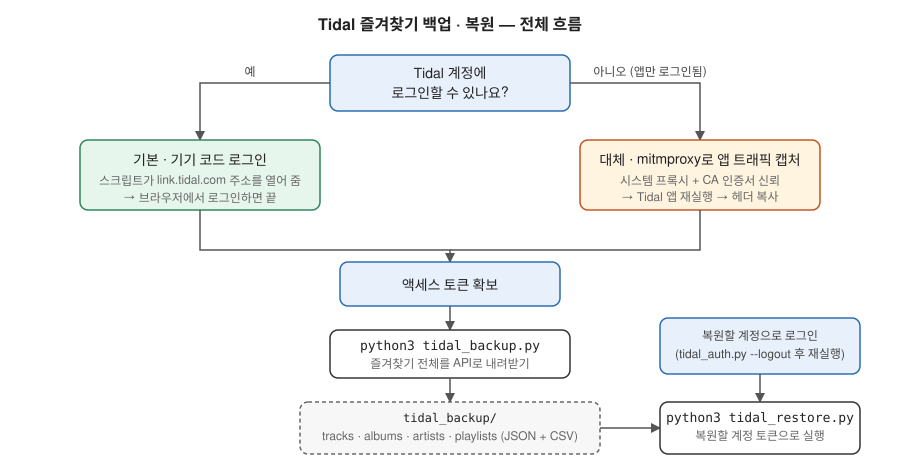
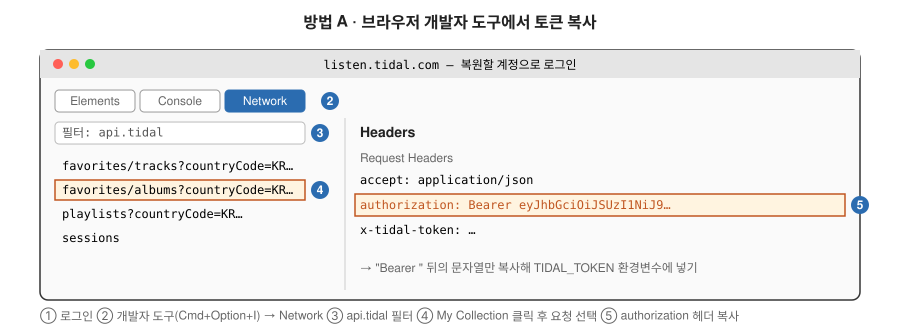

# Tidal 즐겨찾기 백업 · 복원

[English](README.md) | 한국어

Tidal에 즐겨찾기한 트랙·앨범·아티스트·플레이리스트와 직접 만든 플레이리스트를 **JSON + CSV로 백업**하고, 같은 계정이나 다른 계정에 **그대로 복원**하는 파이썬 스크립트입니다.

Tidal은 즐겨찾기 내보내기 기능을 제공하지 않고, 서드파티 서비스(Soundiiz 등)는 웹 로그인이 필요합니다. 이 저장소는 Tidal 앱이 내부적으로 쓰는 API를 그대로 호출하기 때문에 **웹 로그인이 막힌 상태에서 데스크톱 앱에만 로그인이 살아 있어도** 백업할 수 있습니다.



- 표준 라이브러리만 사용 (설치할 패키지 없음, Python 3.8+)
- macOS 기준으로 작성했지만 스크립트 자체는 OS 무관
- 백업 결과에는 ISRC/UPC가 포함되어 다른 서비스로 옮길 때 매칭에 쓸 수 있음

## 목차

1. [준비물](#준비물)
2. [백업](#백업)
   - [A. 웹 로그인이 가능한 경우](#a-웹-로그인이-가능한-경우)
   - [B. 앱에만 로그인되어 있는 경우 (mitmproxy)](#b-앱에만-로그인되어-있는-경우-mitmproxy)
   - [백업 스크립트 실행](#백업-스크립트-실행)
3. [복원](#복원)
4. [문제 해결](#문제-해결)
5. [주의사항](#주의사항)

---

## 준비물

- Python 3.8 이상 (`python3 --version`)
- 이 저장소의 `tidal_backup.py`, `tidal_restore.py`
- Tidal 계정의 **액세스 토큰** — 아래 A 또는 B 방법으로 얻습니다

토큰은 `authorization: Bearer eyJ…` 헤더의 `Bearer ` 뒤에 오는 긴 문자열입니다. 비밀번호와 같은 효력이 있으니 절대 공유하거나 커밋하지 마세요. 보통 몇 시간 뒤 만료됩니다.

## 백업

### A. 웹 로그인이 가능한 경우

가장 간단합니다. 프록시나 별도 도구가 필요 없습니다.



1. 브라우저에서 <https://listen.tidal.com> 에 로그인합니다.
2. 개발자 도구를 엽니다. Chrome은 `Cmd+Option+I`, Safari는 메뉴 **개발자용 → 웹 속성 보기** (메뉴가 없으면 Safari 설정 → 고급 → "메뉴 막대에서 개발자용 메뉴 보기" 체크).
3. **Network** 탭을 선택하고 필터에 `api.tidal`을 입력합니다.
4. 페이지에서 **My Collection**을 클릭해 요청을 발생시킨 뒤 목록의 아무 요청이나 클릭합니다.
5. **Headers → Request Headers**에서 `authorization` 값 중 `Bearer ` 뒤 문자열을 복사합니다.

[백업 스크립트 실행](#백업-스크립트-실행)으로 넘어가세요.

### B. 앱에만 로그인되어 있는 경우 (mitmproxy)

웹 로그인이 불가능하지만 데스크톱 앱은 로그인이 유지되는 상황입니다. 앱이 서버와 주고받는 트래픽을 로컬 프록시로 지나가게 해서 토큰을 읽습니다.


#### B-1. mitmproxy 설치 및 실행

```bash
brew install mitmproxy
mitmweb
```

터미널에 다음 두 줄이 보여야 합니다.

```
HTTP(S) proxy listening at *:8080.
Web server listening at http://127.0.0.1:8081/?token=...
```

**8080은 프록시 포트, 8081은 화면 UI**입니다. 브라우저로 `localhost:8080`을 열면 "Request destination unknown" 오류가 나는데 정상입니다. UI는 터미널에 찍힌 8081 주소(토큰 포함)로 여세요.

#### B-2. 시스템 프록시 설정

**시스템 설정 → 네트워크 → (Wi-Fi 또는 이더넷) → 세부사항… → 프록시**에서

- **웹 프록시(HTTP)** 켜기 → 서버 `127.0.0.1`, 포트 `8080`
- **보안 웹 프록시(HTTPS)** 켜기 → 서버 `127.0.0.1`, 포트 `8080`

두 개 모두 켜야 합니다 (Tidal API는 HTTPS). 승인 후 적용됩니다.

터미널로 하려면 (Wi-Fi 기준, 이더넷이면 `Wi-Fi`를 `Ethernet`으로):

```bash
networksetup -setwebproxy Wi-Fi 127.0.0.1 8080
networksetup -setsecurewebproxy Wi-Fi 127.0.0.1 8080
```

프록시가 물렸는지 확인:

```bash
curl -v -x http://127.0.0.1:8080 http://example.com
```

mitmweb 화면에 `example.com` 요청이 올라오면 정상입니다.

#### B-3. CA 인증서 신뢰

HTTPS를 풀어 보려면 mitmproxy가 만든 CA 인증서를 macOS가 신뢰해야 합니다. 터미널 한 줄이 가장 확실합니다.

```bash
sudo security add-trusted-cert -d -r trustRoot \
  -k /Library/Keychains/System.keychain ~/.mitmproxy/mitmproxy-ca-cert.pem
```

> GUI로 할 경우: 프록시가 켜진 상태에서 브라우저로 `http://mitm.it` → macOS용 인증서 다운로드 → 키체인 접근에서 **"시스템 루트"가 아니라 "로그인" 또는 "시스템"** 키체인에 추가 → 인증서 더블클릭 → 신뢰 → "항상 신뢰". "시스템 루트 키체인을 수정할 수 없습니다"가 뜨면 시스템 루트에 넣으려 한 것입니다.

확인 (`-k` 없이 통과하면 성공, 응답 내용은 401이어도 무관):

```bash
curl -x http://127.0.0.1:8080 https://api.tidal.com/v1/ping
```

#### B-4. Tidal 앱 재실행 → 토큰 복사

1. Tidal 앱을 `Cmd+Q`로 완전히 종료한 뒤 다시 실행합니다 (그래야 새 프록시 설정을 탑니다).
2. My Collection에서 즐겨찾기 목록을 열고 스크롤합니다.
3. mitmweb 화면에 `api.tidal.com` 요청들이 쌓이면 아무거나 클릭 → **Request** 탭 → `authorization` 헤더에서 `Bearer ` 뒤 문자열을 복사합니다.

#### B-5. 프록시 원복

토큰을 얻었으면 시스템 프록시를 끄세요. 켜둔 채 mitmweb을 종료하면 인터넷이 끊긴 것처럼 보입니다.

```bash
networksetup -setwebproxystate Wi-Fi off
networksetup -setsecurewebproxystate Wi-Fi off
```

### 백업 스크립트 실행

```bash
export TIDAL_TOKEN='eyJ…'      # Bearer 뒤 문자열
python3 tidal_backup.py
```

결과는 `./tidal_backup/` 아래에 생성됩니다.

```
tidal_backup/
├── tracks.json / tracks.csv          # 즐겨찾기 트랙 (id, 제목, 아티스트, 앨범, ISRC, 추가일)
├── albums.json / albums.csv          # 즐겨찾기 앨범 (UPC 포함)
├── artists.json / artists.csv        # 즐겨찾기 아티스트
├── playlists.json / playlists.csv    # 즐겨찾기(팔로우)한 플레이리스트
├── my_playlists.json / .csv          # 내가 만든 플레이리스트 목록
└── playlist_tracks/                  # 내 플레이리스트별 트랙 목록
```

JSON은 API 응답 원본이고 CSV는 사람이 보기 좋게 추린 것입니다. 복원에는 JSON을 씁니다.

## 복원

복원할 계정은 웹 로그인이 가능하다고 가정합니다. [방법 A](#a-웹-로그인이-가능한-경우)로 **복원할 계정의** 토큰을 얻으세요.

```bash
export TIDAL_TOKEN='복원할 계정의 토큰'
DRY_RUN=1 python3 tidal_restore.py    # 실제 요청 없이 계획만 출력
python3 tidal_restore.py              # 복원 실행
```

동작:

- 트랙·앨범·아티스트 즐겨찾기를 50개씩 묶어 추가합니다. 백업이 최신순이므로 뒤집어서 오래된 것부터 넣어 상대 순서를 유지합니다 (추가 날짜 자체는 복원 시점으로 바뀝니다).
- 팔로우한 플레이리스트는 uuid로 다시 팔로우합니다.
- 내가 만든 플레이리스트는 같은 제목으로 새로 만들고 트랙을 채웁니다. 원래 uuid는 유지되지 않습니다.
- 현재 지역에서 사라진 곡은 건너뜁니다.

옵션:

| 환경변수 | 설명 |
|---|---|
| `DRY_RUN=1` | 요청을 보내지 않고 무엇을 할지만 출력 |
| `SKIP=tracks,albums,artists,playlists,my_playlists` | 지정한 항목은 건너뜀 (쉼표 구분) |
| `TIDAL_API` | 기본값 `https://api.tidal.com/v1` |

복원 후 `tidal_backup.py`를 한 번 더 돌려 개수를 비교하면 누락분을 확인할 수 있습니다.

재실행 시 즐겨찾기는 중복되지 않지만 내 플레이리스트는 다시 생성되므로 `SKIP=my_playlists`를 붙이세요.

## 문제 해결

| 증상 | 원인 / 해결 |
|---|---|
| `HTTP 401` | 토큰 만료. 브라우저 새로고침 또는 앱 재실행 후 다시 복사 |
| `HTTP 403` / `404` | 다른 계정의 userId로 요청 중이거나 API 호스트가 다름. `TIDAL_API` 확인 |
| mitmweb에서 `Request destination unknown` | 브라우저로 8080을 직접 연 것. UI는 8081 |
| `curl -x … ` 가 `Connection refused` | 8080에 mitmproxy가 없음. `lsof -nP -iTCP:8080 -sTCP:LISTEN`으로 확인, 겹치면 `mitmweb -p 8888` |
| `curl -x …` 가 timeout | VPN/보안 에이전트가 로컬 프록시를 막는 중. 잠시 끄거나 다른 네트워크 |
| `certificate verify failed` | CA 인증서 신뢰 안 됨. B-3 다시 |
| `시스템 루트 키체인을 수정할 수 없습니다` | 시스템 루트 대신 로그인/시스템 키체인에 추가, 또는 B-3의 `security` 명령 사용 |
| Tidal 요청이 mitmweb에 안 잡힘 | 앱을 `Cmd+Q`로 완전히 종료 후 재실행했는지 확인 |

## 주의사항

- **토큰은 비밀번호입니다.** 셸 히스토리에 남기고 싶지 않으면 `read -s TIDAL_TOKEN && export TIDAL_TOKEN` 으로 입력하세요.
- `tidal_backup/`에는 개인 청취 데이터가 들어 있습니다. `.gitignore`에 포함되어 있지만 커밋 전에 확인하세요.
- mitmproxy 작업이 끝나면 프록시를 끄고, 필요하면 키체인에서 mitmproxy CA 인증서도 삭제하세요.
- Tidal의 비공식 API를 사용합니다. Tidal 측 변경으로 언제든 동작하지 않을 수 있습니다.
- 다른 스트리밍 서비스로 옮기는 것이 목적이면 `tidal_backup/tracks.csv`(ISRC 포함)를 Soundiiz·TuneMyMusic 등의 CSV 가져오기에 넣는 편이 매칭이 정확합니다.

## 라이선스

MIT
