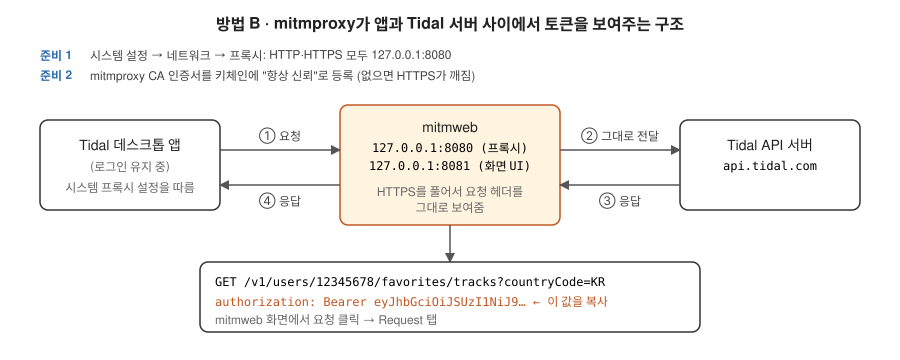

# Tidal 즐겨찾기 백업 · 복원

[English](README.md) | 한국어

Tidal에 즐겨찾기한 트랙·앨범·아티스트·플레이리스트와 직접 만든 플레이리스트를 **JSON + CSV로 백업**하고, 같은 계정이나 다른 계정에 **그대로 복원**하는 파이썬 스크립트입니다.

Tidal은 즐겨찾기 내보내기 기능을 제공하지 않고, 서드파티 서비스(Soundiiz 등)는 웹 로그인이 필요합니다. 이 저장소는 Tidal 앱이 내부적으로 쓰는 API를 그대로 호출하기 때문에 **새로 로그인할 수 없는 상태여도** 브라우저나 데스크톱 앱에 세션만 살아 있으면 백업할 수 있습니다.


- 표준 라이브러리만 사용 (설치할 패키지 없음, Python 3.8+)
- macOS 기준으로 작성했지만 스크립트 자체는 OS 무관
- 백업 결과에는 ISRC/UPC가 포함되어 다른 서비스로 옮길 때 매칭에 쓸 수 있음

## 목차

1. [준비물](#준비물)
2. [어떤 경우에 해당하나요?](#어떤-경우에-해당하나요)
3. [백업](#백업) — [경우 1: 로그인할 수 있다](#경우-1--tidal에-로그인할-수-있다)
4. [복원](#복원)
5. [새로 로그인할 수 없는 경우](#새로-로그인할-수-없는-경우)
   - [경우 2: 브라우저에 세션이 살아 있다](#경우-2--브라우저에-세션이-살아-있다)
   - [경우 3: 데스크톱 앱에만 세션이 살아 있다](#경우-3--데스크톱-앱에만-세션이-살아-있다)
6. [문제 해결](#문제-해결)
7. [주의사항](#주의사항)

---

## 준비물

- Python 3.8 이상 (`python3 --version`)
- 이 저장소의 `.py` 파일 3개 — 같은 폴더에 두면 됩니다

```bash
git clone https://github.com/lifefeel/tidal-favorites-backup.git
cd tidal-favorites-backup
```

git을 쓰지 않는다면 이 저장소의 GitHub 페이지에서 **Code → Download ZIP** 을 눌러 받은 뒤 압축을 푸세요. 그 폴더에서 터미널을 열면 됩니다 (Finder에서 폴더를 우클릭 → **서비스 → 폴더에서 새로운 터미널 열기**).

그 외에 설치할 것은 없습니다. 표준 라이브러리만 씁니다.

## 어떤 경우에 해당하나요?

아래 내용은 결국 한 가지 질문으로 갈립니다. **지금 그 Tidal 계정에 새로 로그인할 수 있나요?** 해당하는 줄을 먼저 찾고 그 경우로 넘어가세요.

| 내 상황 | 경우 | 들어가는 방법 |
|---|---|---|
| 비밀번호를 알고 2단계 인증도 통과할 수 있다 | **[경우 1](#경우-1--tidal에-로그인할-수-있다)** | 스크립트만 실행하면 브라우저에 로그인 링크가 열립니다 |
| 새로 로그인은 못 하지만 `listen.tidal.com` 에서 내 컬렉션이 열린다 | **[경우 2](#경우-2--브라우저에-세션이-살아-있다)** | 살아 있는 웹 세션에서 개발자 도구로 토큰을 꺼냅니다 |
| 새로 로그인도 못 하고 브라우저도 로그아웃됐지만 데스크톱 앱은 쓸 수 있다 | **[경우 3](#경우-3--데스크톱-앱에만-세션이-살아-있다)** | mitmproxy로 앱 트래픽에서 토큰을 캡처합니다 |

경우 2와 3에서 얻는 토큰은 갱신되지 않고 몇 시간이면 만료되므로, 복사한 뒤 한 번에 백업을 끝내세요. 그리고 **어느 쪽이든 절대 로그아웃하지 마세요.** 남아 있는 그 세션이 유일한 통로입니다.

## 백업

### 경우 1 · Tidal에 로그인할 수 있다

```bash
python3 tidal_backup.py
```

처음 실행하면 `https://link.tidal.com/ABCDE` 같은 주소가 출력되면서 브라우저가 열립니다. 거기서 Tidal에 로그인하면 스크립트가 알아서 이어집니다. 개발자 도구도, 프록시도, 복사·붙여넣기도 필요 없습니다.

토큰은 현재 폴더의 `tidal_auth.token` 에 저장되므로 다음부터는 바로 실행됩니다. 스스로 갱신하기 때문에 백업 도중 만료될 일도 없습니다. 로그아웃하거나 계정을 바꾸려면:

```bash
python3 tidal_auth.py --logout
```

저장된 토큰은 다음 실행 때 그대로 재사용되므로, 스크립트는 내려받기 전에 **지금 어느 계정을 쓰는지** 항상 먼저 출력합니다. 그 줄에 엉뚱한 계정이 찍히면 멈추고 `--logout` 부터 하세요.

> **이 계정으로 로그인할 수 없다면?** 경우 2 또는 3에 해당합니다. [새로 로그인할 수 없는 경우](#새로-로그인할-수-없는-경우)를 보세요.

결과는 `./tidal_backup/` 아래에 생성됩니다.

```
tidal_backup/
├── tracks.json / tracks.csv          # 즐겨찾기 트랙 (id, 제목, 아티스트, 앨범, ISRC, 추가일)
├── albums.json / albums.csv          # 즐겨찾기 앨범 (UPC 포함)
├── artists.json / artists.csv        # 즐겨찾기 아티스트
├── playlists.json / playlists.csv    # 즐겨찾기(팔로우)한 플레이리스트
├── my_playlists.json / .csv          # 내가 만든 플레이리스트 목록
├── playlist_tracks/                  # 내 플레이리스트별 트랙 목록
└── unavailable_ids.json              # 목록에 안 나온 즐겨찾기가 있을 때만 생성
```

JSON은 API 응답 원본이고 CSV는 사람이 보기 좋게 추린 것입니다. 복원에는 JSON을 씁니다.

Tidal 목록 API는 카탈로그에서 삭제된 곡·앨범을 즐겨찾기 목록에서 말없이 뺍니다. 스크립트는 계정의 즐겨찾기 ID 목록과 비교해, 빠진 것이 있으면 경고를 띄우고 그 ID를 `unavailable_ids.json`에 남깁니다. 이 항목들은 Tidal이 404를 돌려주므로 복원할 수 없지만, 무엇이 사라졌는지는 알 수 있습니다.

## 복원

복원은 `./tidal_backup/` 을 읽어 **지금 로그인된 계정**에 씁니다. 백업한 계정의 자격증명을 먼저 지우세요.

```bash
unset TIDAL_TOKEN                     # 경우 2·3으로 백업했을 때만 필요
python3 tidal_auth.py --logout        # 백업한 계정에서 로그아웃
DRY_RUN=1 python3 tidal_restore.py    # 실제 요청 없이 계획만 출력
python3 tidal_restore.py              # 복원할 계정으로 로그인한 뒤 복원 실행
```

스크립트는 아무것도 쓰기 전에 어느 계정에 복원할지 출력하고 `y` 를 기다립니다.

```
복원 대상: you@example.com (userId=123456789) country=KR
이 계정에 복원합니다. 계속할까요? [y/N]
```

**답하기 전에 이 줄을 반드시 확인하세요.** 마지막 확인 지점이며, 엉뚱한 계정에 들어간 즐겨찾기는 손으로 지우는 수밖에 없습니다. 자동화할 때는 `YES=1` 로 프롬프트를 건너뛸 수 있고, 터미널이 없으면 스크립트는 짐작하지 않고 실행을 거부합니다.

> **어느 토큰이 우선인가?** `TIDAL_TOKEN` 환경변수는 저장된 `tidal_auth.token` 보다 **항상 우선**하며, 설정되어 있으면 스크립트가 시작할 때 그 사실을 알려 줍니다. 환경변수가 남아 있는 한 `--logout` 만으로는 계정이 바뀌지 않습니다. `unset` 이 먼저인 이유입니다.

동작:

- 트랙·앨범·아티스트 즐겨찾기를 오래된 것부터 하나씩 추가해, 앱의 '최근 추가순'이 원래 계정과 같아지게 합니다 (추가 날짜 자체는 복원 시점으로 바뀝니다). 한 요청에 여러 개를 넣으면 모두 같은 시각이 찍혀 순서가 섞이므로, 묶어 보내기는 `BATCH`로 직접 켤 때만 씁니다.
- 팔로우한 플레이리스트는 uuid로 다시 팔로우합니다.
- 내가 만든 플레이리스트는 같은 제목으로 새로 만들고 트랙을 채웁니다. 원래 uuid는 유지되지 않습니다.
- 현재 지역에서 사라진 곡은 건너뜁니다.

옵션:

| 환경변수 | 설명 |
|---|---|
| `DRY_RUN=1` | 요청을 보내지 않고 무엇을 할지만 출력 |
| `SKIP=tracks,albums,artists,playlists,my_playlists` | 지정한 항목은 건너뜀 (쉼표 구분) |
| `BATCH=50` | 한 요청에 넣을 개수 (기본 `1`). 빨라지지만 같은 요청에 든 항목끼리는 '최근 추가순'이 섞입니다 |
| `TIDAL_API` | 기본값 `https://api.tidal.com/v1` |

복원 후 `tidal_backup.py`를 한 번 더 돌려 개수를 비교하면 누락분을 확인할 수 있습니다.

재실행 시 즐겨찾기는 중복되지 않지만 내 플레이리스트는 다시 생성되므로 `SKIP=my_playlists`를 붙이세요.

## 새로 로그인할 수 없는 경우

비밀번호를 잊었거나, 2단계 인증 기기를 분실했거나, 더 이상 쓸 수 없는 SSO 계정 — 로그인은 불가능하지만 이미 만들어진 세션이 어딘가에 남아 있다면 그 안에 유효한 토큰이 들어 있습니다. 아래 두 경우는 그 토큰을 꺼내는 절차이고, 차이는 **살아 있는 세션이 어디에 있느냐** 뿐입니다.

토큰을 얻었으면 `TIDAL_TOKEN` 으로 넘기세요. 스크립트가 로그인을 건너뛰고 그 토큰을 씁니다. 이 값은 **저장된 로그인을 덮어쓰므로**, 다 쓰고 나면 `unset TIDAL_TOKEN` 하세요. 특히 다른 계정으로 복원하기 전에는 반드시 필요합니다.

```bash
export TIDAL_TOKEN='eyJ…'      # Bearer 뒤 문자열
python3 tidal_backup.py
```

이렇게 얻은 토큰은 갱신되지 않고 보통 몇 시간이면 만료되므로 복사 직후에 백업을 돌리세요. 비밀번호와 같은 효력이 있으니 절대 공유하거나 커밋하지 마세요.

### 경우 2 · 브라우저에 세션이 살아 있다

새로 로그인은 못 했는데 `listen.tidal.com` 을 열면 내 컬렉션이 그대로 보이는 상태입니다. 살아 있는 세션의 토큰이 요청 헤더에 들어 있으므로 로그인 없이 꺼내 쓸 수 있고, 추가로 설치할 도구도 없습니다.

경우 1의 기기 코드 링크가 동작하지 않을 때의 대체 수단으로도 같은 절차를 쓸 수 있습니다.


1. 브라우저에서 <https://listen.tidal.com> 을 엽니다. 내 컬렉션이 보이면 세션이 살아 있는 것입니다. 이때 **절대 로그아웃하지 마세요.** 유일한 통로가 사라집니다.
2. 개발자 도구를 엽니다. Chrome은 `Cmd+Option+I`, Safari는 메뉴 **개발자용 → 웹 속성 보기** (메뉴가 없으면 Safari 설정 → 고급 → "메뉴 막대에서 개발자용 메뉴 보기" 체크).
3. **Network** 탭을 선택하고 필터에 `api.tidal`을 입력합니다.
4. 페이지에서 **My Collection**을 클릭해 요청을 발생시킨 뒤 목록의 아무 요청이나 클릭합니다.
5. **Headers → Request Headers**에서 `authorization` 값 중 `Bearer ` 뒤 문자열을 복사합니다.

### 경우 3 · 데스크톱 앱에만 세션이 살아 있다

브라우저마저 로그아웃된 상태에서, 세션이 남은 마지막 장소가 데스크톱 앱인 상황입니다. 앱이 서버와 주고받는 트래픽을 로컬 프록시로 지나가게 해서 토큰을 읽습니다.



#### 1단계. mitmproxy 설치 및 실행

```bash
brew install mitmproxy
mitmweb
```

터미널에 다음 두 줄이 보여야 합니다.

```
HTTP(S) proxy listening at *:8080.
Web server listening at http://127.0.0.1:8081/?token=...
```

**8080은 프록시 포트, 8081은 화면 UI**입니다. 브라우저로 `localhost:8080`을 열면 "Request destination unknown" 오류가 나는데 정상입니다. UI는 터미널에 찍힌 8081 주소(토큰 포함)로 여세요.

#### 2단계. 시스템 프록시 설정

**시스템 설정 → 네트워크 → (Wi-Fi 또는 이더넷) → 세부사항… → 프록시**에서

- **웹 프록시(HTTP)** 켜기 → 서버 `127.0.0.1`, 포트 `8080`
- **보안 웹 프록시(HTTPS)** 켜기 → 서버 `127.0.0.1`, 포트 `8080`

두 개 모두 켜야 합니다 (Tidal API는 HTTPS). 승인 후 적용됩니다.

터미널로 하려면 (Wi-Fi 기준, 이더넷이면 `Wi-Fi`를 `Ethernet`으로):

```bash
networksetup -setwebproxy Wi-Fi 127.0.0.1 8080
networksetup -setsecurewebproxy Wi-Fi 127.0.0.1 8080
```

프록시가 물렸는지 확인:

```bash
curl -v -x http://127.0.0.1:8080 http://example.com
```

mitmweb 화면에 `example.com` 요청이 올라오면 정상입니다.

#### 3단계. CA 인증서 신뢰

HTTPS를 풀어 보려면 mitmproxy가 만든 CA 인증서를 macOS가 신뢰해야 합니다. 터미널 한 줄이 가장 확실합니다.

```bash
sudo security add-trusted-cert -d -r trustRoot \
  -k /Library/Keychains/System.keychain ~/.mitmproxy/mitmproxy-ca-cert.pem
```

> GUI로 할 경우: 프록시가 켜진 상태에서 브라우저로 `http://mitm.it` → macOS용 인증서 다운로드 → 키체인 접근에서 **"시스템 루트"가 아니라 "로그인" 또는 "시스템"** 키체인에 추가 → 인증서 더블클릭 → 신뢰 → "항상 신뢰". "시스템 루트 키체인을 수정할 수 없습니다"가 뜨면 시스템 루트에 넣으려 한 것입니다.

확인 (`-k` 없이 통과하면 성공, 응답 내용은 401이어도 무관):

```bash
curl -x http://127.0.0.1:8080 https://api.tidal.com/v1/ping
```

#### 4단계. Tidal 앱 재실행 → 토큰 복사

1. Tidal 앱을 `Cmd+Q`로 완전히 종료한 뒤 다시 실행합니다 (그래야 새 프록시 설정을 탑니다).
2. My Collection에서 즐겨찾기 목록을 열고 스크롤합니다.
3. mitmweb 화면에 `api.tidal.com` 요청들이 쌓이면 아무거나 클릭 → **Request** 탭 → `authorization` 헤더에서 `Bearer ` 뒤 문자열을 복사합니다.

#### 5단계. 프록시 원복

토큰을 얻었으면 시스템 프록시를 끄세요. 켜둔 채 mitmweb을 종료하면 인터넷이 끊긴 것처럼 보입니다.

```bash
networksetup -setwebproxystate Wi-Fi off
networksetup -setsecurewebproxystate Wi-Fi off
```

## 문제 해결

| 증상 | 원인 / 해결 |
|---|---|
| 처음 실행했는데 브라우저가 안 열림 | 출력된 `https://link.tidal.com/…` 주소를 직접 복사해 여세요 |
| `시간이 초과되었습니다` | 코드는 5분 뒤 만료됩니다. 스크립트를 다시 실행하세요 |
| `HTTP 401` | 토큰 만료. `python3 tidal_auth.py --logout` 후 재실행. `TIDAL_TOKEN` 사용 중이면 새로 복사 |
| 복원 대상이 엉뚱한 계정 | 프롬프트에 `n` 을 입력해 취소한 뒤 `unset TIDAL_TOKEN` 과 `python3 tidal_auth.py --logout` 을 하고 다시 실행 |
| `HTTP 403` / `404` | 다른 계정의 userId로 요청 중이거나 API 호스트가 다름. `TIDAL_API` 확인 |
| mitmweb에서 `Request destination unknown` | 브라우저로 8080을 직접 연 것. UI는 8081 |
| `curl -x … ` 가 `Connection refused` | 8080에 mitmproxy가 없음. `lsof -nP -iTCP:8080 -sTCP:LISTEN`으로 확인, 겹치면 `mitmweb -p 8888` |
| `curl -x …` 가 timeout | VPN/보안 에이전트가 로컬 프록시를 막는 중. 잠시 끄거나 다른 네트워크 |
| `certificate verify failed` | CA 인증서 신뢰 안 됨. 3단계를 다시 |
| `시스템 루트 키체인을 수정할 수 없습니다` | 시스템 루트 대신 로그인/시스템 키체인에 추가, 또는 3단계의 `security` 명령 사용 |
| Tidal 요청이 mitmweb에 안 잡힘 | 앱을 `Cmd+Q`로 완전히 종료 후 재실행했는지 확인 |

## 주의사항

- **토큰은 비밀번호입니다.** `tidal_auth.token` 은 `600` 권한으로 만들어지며 `.gitignore` 에 포함되어 있습니다. `TIDAL_TOKEN` 을 직접 지정할 때는 셸 히스토리에 남지 않도록 `read -s TIDAL_TOKEN && export TIDAL_TOKEN` 으로 입력하세요.
- `tidal_backup/`에는 개인 청취 데이터가 들어 있습니다. `.gitignore`에 포함되어 있지만 커밋 전에 확인하세요.
- mitmproxy 작업이 끝나면 프록시를 끄고, 필요하면 키체인에서 mitmproxy CA 인증서도 삭제하세요.
- 로그인에는 OAuth 기기 코드 플로우([RFC 8628](https://datatracker.ietf.org/doc/html/rfc8628))와, Tidal이 자사 TV·기기용 앱에 넣어 배포하는 공개 클라이언트 자격증명을 사용합니다. 다른 오픈소스 Tidal 클라이언트들도 같은 값을 씁니다. 사용자가 아니라 클라이언트 앱을 식별하는 값이라 비밀이 아닙니다. 이 프로젝트는 외부 코드를 포함하지 않으며 Tidal과 아무런 제휴 관계가 없습니다.
- Tidal의 비공식 API를 사용합니다. Tidal 측 변경으로 언제든 동작하지 않을 수 있습니다.
- 다른 스트리밍 서비스로 옮기는 것이 목적이면 `tidal_backup/tracks.csv`(ISRC 포함)를 Soundiiz·TuneMyMusic 등의 CSV 가져오기에 넣는 편이 매칭이 정확합니다.

## 라이선스

MIT
