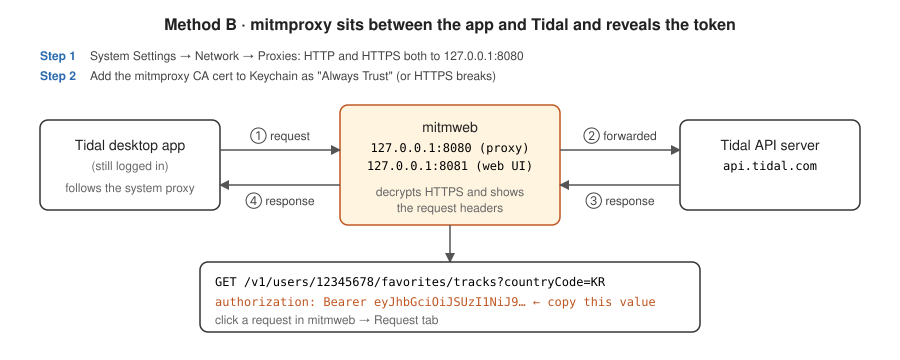

# Tidal Favorites Backup & Restore

English | [한국어](README.ko.md)

A few small Python scripts that **export your Tidal favorites** (tracks, albums, artists, followed playlists, and your own playlists) to **JSON + CSV**, and **restore them** to the same or another Tidal account.

Tidal has no export feature, and third-party tools like Soundiiz require a web login. These scripts call the same internal API the Tidal apps use, so they work **even when you can't log in on the web and only the desktop app still has a live session**.


- Standard library only, no packages to install (Python 3.8+)
- Written and tested on macOS; the scripts themselves are OS-independent
- Exports include ISRC/UPC codes, useful for matching when migrating to another service

## Contents

1. [Prerequisites](#prerequisites)
2. [Backup](#backup)
   - [Run the backup script](#run-the-backup-script)
3. [Restore](#restore)
4. [If you can't sign in](#if-you-cant-sign-in)
   - [A. Copy the token from the browser](#a-copy-the-token-from-the-browser)
   - [B. Only the desktop app is logged in (mitmproxy)](#b-only-the-desktop-app-is-logged-in-mitmproxy)
5. [Troubleshooting](#troubleshooting)
6. [Notes & caveats](#notes--caveats)

---

## Prerequisites

- Python 3.8 or newer (`python3 --version`)
- The three `.py` files from this repo, kept in the same folder:

```bash
git clone https://github.com/lifefeel/tidal-favorites-backup.git
cd tidal-favorites-backup
```

Nothing else to install — the scripts use only the Python standard library.

## Backup

### Run the backup script

```bash
python3 tidal_backup.py
```

The first run prints a link like `https://link.tidal.com/ABCDE` and opens it in your browser. Sign in to Tidal there, and the script continues on its own — no DevTools, no proxy, nothing to copy and paste.

The token is saved to `tidal_auth.token` in the current folder, so later runs start immediately. It refreshes itself, so it won't expire on you mid-backup. To sign out or switch accounts:

```bash
python3 tidal_auth.py --logout
```

> **Can't sign in to this account?** If you've forgotten the password but the desktop app is still logged in, see [If you can't sign in](#if-you-cant-sign-in).

Output goes to `./tidal_backup/`:

```
tidal_backup/
├── tracks.json / tracks.csv          # favorite tracks (id, title, artists, album, ISRC, date added)
├── albums.json / albums.csv          # favorite albums (with UPC)
├── artists.json / artists.csv        # favorite artists
├── playlists.json / playlists.csv    # playlists you follow
├── my_playlists.json / .csv          # playlists you created
└── playlist_tracks/                  # track list for each of your playlists
```

JSON files are the raw API responses; CSVs are a human-readable subset. Restore uses the JSON.

## Restore

Restore reads `./tidal_backup/` and writes into **whichever account you sign in as** — so sign out first if the token on disk belongs to the source account.

```bash
python3 tidal_auth.py --logout        # sign out of the source account
DRY_RUN=1 python3 tidal_restore.py    # print the plan, send nothing
python3 tidal_restore.py              # sign in as the target account, then restore
```

What it does:

- Adds track/album/artist favorites in batches of 50. The backup is newest-first, so it's reversed to preserve relative order (the "date added" itself becomes the restore time).
- Re-follows playlists by UUID.
- Recreates your own playlists with the same titles and fills them with tracks. Original UUIDs are not preserved.
- Skips tracks no longer available in your region.

Options:

| Env var | Description |
|---|---|
| `DRY_RUN=1` | Print what would be done without sending requests |
| `SKIP=tracks,albums,artists,playlists,my_playlists` | Comma-separated categories to skip |
| `TIDAL_API` | Defaults to `https://api.tidal.com/v1` |

Run `tidal_backup.py` again afterwards and compare counts to spot anything that was skipped.

Favorites are idempotent, so re-running is safe — but your own playlists would be created again, so pass `SKIP=my_playlists` on subsequent runs.

## If you can't sign in

Both paths below produce a raw access token. Pass it in `TIDAL_TOKEN` and the scripts will use it instead of signing in:

```bash
export TIDAL_TOKEN='eyJ…'      # the part after "Bearer "
python3 tidal_backup.py
```

Such a token is not refreshable and usually expires after a few hours. Treat it like a password: never share it or commit it.

### A. Copy the token from the browser

Useful if the device-code link doesn't work for you but web login does.


1. Log in at <https://listen.tidal.com>.
2. Open DevTools: `Cmd+Option+I` in Chrome, or **Develop → Show Web Inspector** in Safari (enable the Develop menu under Safari Settings → Advanced if it's missing).
3. Select the **Network** tab and type `api.tidal` in the filter box.
4. Click **My Collection** on the page to trigger requests, then click any request in the list.
5. Under **Headers → Request Headers**, copy the value of `authorization` *without* the `Bearer ` prefix.

### B. Only the desktop app is logged in (mitmproxy)

For the case where web login fails but the desktop app still has a session. We route the app's traffic through a local proxy and read the token from the request headers.



#### B-1. Install and start mitmproxy

```bash
brew install mitmproxy
mitmweb
```

You should see these two lines in the terminal:

```
HTTP(S) proxy listening at *:8080.
Web server listening at http://127.0.0.1:8081/?token=...
```

**8080 is the proxy port, 8081 is the web UI.** Opening `localhost:8080` in a browser gives a "Request destination unknown" error, which is expected. Open the UI via the 8081 URL (including the token) printed in the terminal.

#### B-2. Set the system proxy

**System Settings → Network → (Wi-Fi or Ethernet) → Details… → Proxies**:

- Enable **Web Proxy (HTTP)** → server `127.0.0.1`, port `8080`
- Enable **Secure Web Proxy (HTTPS)** → server `127.0.0.1`, port `8080`

Both must be enabled (the Tidal API is HTTPS). Click OK to apply.

From the terminal (replace `Wi-Fi` with `Ethernet` if needed):

```bash
networksetup -setwebproxy Wi-Fi 127.0.0.1 8080
networksetup -setsecurewebproxy Wi-Fi 127.0.0.1 8080
```

Verify the proxy is in the path:

```bash
curl -v -x http://127.0.0.1:8080 http://example.com
```

If an `example.com` request shows up in mitmweb, you're good.

#### B-3. Trust the CA certificate

To decrypt HTTPS, macOS must trust mitmproxy's CA certificate. One command does it:

```bash
sudo security add-trusted-cert -d -r trustRoot \
  -k /Library/Keychains/System.keychain ~/.mitmproxy/mitmproxy-ca-cert.pem
```

> Via the GUI: with the proxy enabled, open `http://mitm.it` in a browser → download the macOS certificate → in Keychain Access, add it to the **"login" or "System" keychain, not "System Roots"** → double-click the certificate → Trust → "Always Trust". If you see **"Cannot modify the System Roots keychain"**, you tried to add it to System Roots, which is read-only.

Verify — success if this passes *without* `-k` (a 401 response body is fine):

```bash
curl -x http://127.0.0.1:8080 https://api.tidal.com/v1/ping
```

#### B-4. Relaunch Tidal and copy the token

1. Quit Tidal completely with `Cmd+Q` and relaunch it (otherwise it keeps the old proxy settings).
2. Open My Collection and scroll through your favorites.
3. In mitmweb, click any `api.tidal.com` request → **Request** tab → copy the `authorization` header value without the `Bearer ` prefix.

#### B-5. Turn the proxy back off

Disable the system proxy once you have the token. If you quit mitmweb with the proxy still on, it looks like your internet is down.

```bash
networksetup -setwebproxystate Wi-Fi off
networksetup -setsecurewebproxystate Wi-Fi off
```

## Troubleshooting

| Symptom | Cause / fix |
|---|---|
| The browser doesn't open on the first run | Copy the printed `https://link.tidal.com/…` address by hand |
| `You took too long to log in` | The code expires after 5 minutes. Just run the script again |
| `HTTP 401` | Token expired. Run `python3 tidal_auth.py --logout` and try again; with `TIDAL_TOKEN`, copy a fresh one |
| Restore wrote into the wrong account | `python3 tidal_auth.py --logout`, then rerun and sign in as the target account |
| `HTTP 403` / `404` | Wrong userId for this token, or a different API host. Check `TIDAL_API` |
| mitmweb shows `Request destination unknown` | You opened port 8080 in a browser. The UI is on 8081 |
| `curl -x …` says `Connection refused` | Nothing on 8080. Check `lsof -nP -iTCP:8080 -sTCP:LISTEN`; if something else owns it, run `mitmweb -p 8888` |
| `curl -x …` hangs / times out | A VPN or security agent is blocking the local proxy. Disable it briefly or use another network |
| `certificate verify failed` | CA cert not trusted. Redo B-3 |
| `Cannot modify the System Roots keychain` | Add the cert to the login/System keychain instead, or use the `security` command in B-3 |
| No Tidal requests appear in mitmweb | Make sure you fully quit (`Cmd+Q`) and relaunched the app |

## Notes & caveats

- **The token is a password.** `tidal_auth.token` is created with `600` permissions and is in `.gitignore`. If you set `TIDAL_TOKEN` by hand, keep it out of shell history: `read -s TIDAL_TOKEN && export TIDAL_TOKEN`.
- `tidal_backup/` contains your personal listening data. It's in `.gitignore`, but double-check before committing.
- When you're done with mitmproxy, disable the proxy and optionally remove the mitmproxy CA from your keychain.
- This uses Tidal's unofficial API and may stop working at any time.
- If your goal is migrating to another streaming service, feed `tidal_backup/tracks.csv` (with ISRCs) into the CSV import of Soundiiz, TuneMyMusic, etc. — matching is far more accurate that way.

## License

MIT
