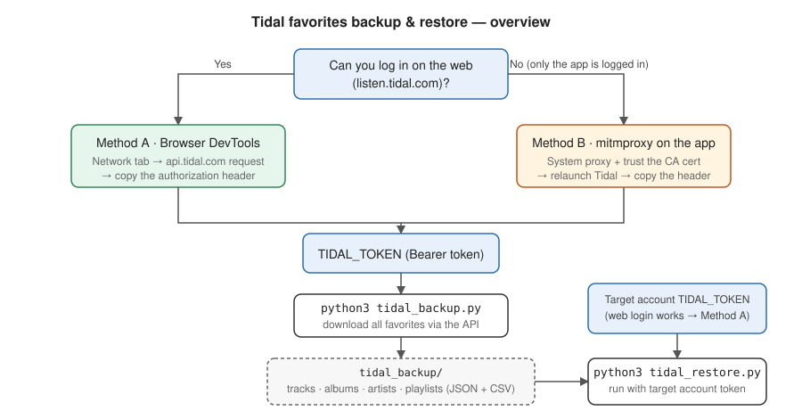
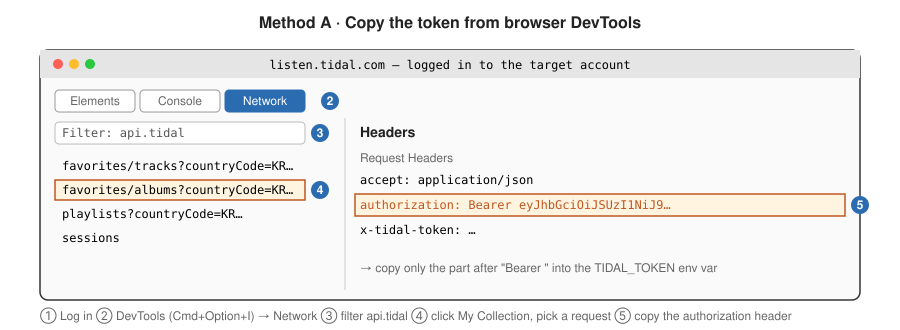

# Tidal Favorites Backup & Restore

English | [한국어](README.ko.md)

A few small Python scripts that **export your Tidal favorites** (tracks, albums, artists, followed playlists, and your own playlists) to **JSON + CSV**, and **restore them** to the same or another Tidal account.

Tidal has no export feature, and third-party tools like Soundiiz require a web login. These scripts call the same internal API the Tidal apps use, so they work **even when you can't sign in at all** — as long as the browser or the desktop app still has a live session.



- Standard library only, no packages to install (Python 3.8+)
- Written and tested on macOS; the scripts themselves are OS-independent
- Exports include ISRC/UPC codes, useful for matching when migrating to another service

## Contents

1. [Prerequisites](#prerequisites)
2. [Which case are you in?](#which-case-are-you-in)
3. [Backup](#backup) — [Case 1: you can sign in](#case-1--you-can-sign-in-to-tidal)
4. [Restore](#restore)
5. [When you can't sign in again](#when-you-cant-sign-in-again)
   - [Case 2: the browser still has a session](#case-2--the-browser-still-has-a-session)
   - [Case 3: only the desktop app has a session](#case-3--only-the-desktop-app-has-a-session)
6. [Troubleshooting](#troubleshooting)
7. [Notes & caveats](#notes--caveats)

---

## Prerequisites

- Python 3.8 or newer (`python3 --version`)
- The three `.py` files from this repo, kept in the same folder:

```bash
git clone https://github.com/lifefeel/tidal-favorites-backup.git
cd tidal-favorites-backup
```

Not a git user? On this repo's GitHub page click **Code → Download ZIP**, unzip it, and open a terminal in the unzipped folder (in Finder: right-click the folder → **Services → New Terminal at Folder**).

Nothing else to install — the scripts use only the Python standard library.

## Which case are you in?

Everything below hinges on one question: **can you still sign in to the Tidal account?** Find your row first, then jump to that case.

| Your situation | Case | How you get in |
|---|---|---|
| You know the password (and can pass 2FA) | **[Case 1](#case-1--you-can-sign-in-to-tidal)** | Just run the script — it opens a sign-in link in your browser |
| You can't sign in again, but `listen.tidal.com` still loads your collection | **[Case 2](#case-2--the-browser-still-has-a-session)** | Read the token out of the live browser session with DevTools |
| You can't sign in again and the browser is signed out, but the desktop app still works | **[Case 3](#case-3--only-the-desktop-app-has-a-session)** | Capture the token from the app's traffic with mitmproxy |

Cases 2 and 3 hand you a raw token that lasts a few hours and cannot be refreshed, so finish your backup in one sitting. **In either case, do not sign out** — the session you still have is the only way in.

## Backup

### Case 1 · You can sign in to Tidal

```bash
python3 tidal_backup.py
```

The first run prints a link like `https://link.tidal.com/ABCDE` and opens it in your browser. Sign in to Tidal there, and the script continues on its own — no DevTools, no proxy, nothing to copy and paste.

The token is saved to `tidal_auth.token` in the current folder, so later runs start immediately. It refreshes itself, so it won't expire on you mid-backup. To sign out or switch accounts:

```bash
python3 tidal_auth.py --logout
```

A saved token is reused on the next run, so the script always prints which account it is using before it downloads anything. If that line names the wrong account, stop and run `--logout` first.

> **Can't sign in to this account?** You're in case 2 or 3 — see [When you can't sign in again](#when-you-cant-sign-in-again).

Output goes to `./tidal_backup/`:

```
tidal_backup/
├── tracks.json / tracks.csv          # favorite tracks (id, title, artists, album, ISRC, date added)
├── albums.json / albums.csv          # favorite albums (with UPC)
├── artists.json / artists.csv        # favorite artists
├── playlists.json / playlists.csv    # playlists you follow
├── my_playlists.json / .csv          # playlists you created
├── playlist_tracks/                  # track list for each of your playlists
└── unavailable_ids.json              # only if some favorites could not be listed
```

JSON files are the raw API responses; CSVs are a human-readable subset. Restore uses the JSON.

Tidal's list API silently leaves out favorites whose track or album has been removed from the catalog. The script compares each list with the account's raw favorite IDs and, if anything is missing, prints a warning and writes those IDs to `unavailable_ids.json`. They can't be restored — Tidal returns 404 for them — but you know what was lost.

## Restore

Restore reads `./tidal_backup/` and writes into **whichever account you're signed in as** — so clear the source account's credentials first.

```bash
unset TIDAL_TOKEN                     # only needed if you used case 2 or 3
python3 tidal_auth.py --logout        # sign out of the source account
DRY_RUN=1 python3 tidal_restore.py    # print the plan, send nothing
python3 tidal_restore.py              # sign in as the target account, then restore
```

Before writing anything, the script prints the account it is about to restore into and waits for a `y`:

```
복원 대상: you@example.com (userId=123456789) country=KR
이 계정에 복원합니다. 계속할까요? [y/N]
```

**Read that line before answering.** It is the last checkpoint — favorites added to the wrong account have to be removed by hand. In scripts, `YES=1` skips the prompt; without a terminal the script refuses to run rather than guessing.

> **Which token wins?** `TIDAL_TOKEN` always takes precedence over the saved `tidal_auth.token`, and the scripts say so on startup when the environment variable is set. `--logout` alone will not help while it is still exported — that's why `unset` comes first.

What it does:

- Adds track/album/artist favorites one at a time, oldest first, so the app's "recently added" order matches the source account (the "date added" itself becomes the restore time). Items added in one request would all share the same timestamp and lose their order, so batching is opt-in via `BATCH`.
- Re-follows playlists by UUID.
- Recreates your own playlists with the same titles and fills them with tracks. Original UUIDs are not preserved.
- Skips tracks no longer available in your region.

Options:

| Env var | Description |
|---|---|
| `DRY_RUN=1` | Print what would be done without sending requests |
| `SKIP=tracks,albums,artists,playlists,my_playlists` | Comma-separated categories to skip |
| `BATCH=50` | Items per request (default `1`). Faster, but items in the same request lose their relative "recently added" order |
| `TIDAL_API` | Defaults to `https://api.tidal.com/v1` |

Run `tidal_backup.py` again afterwards and compare counts to spot anything that was skipped.

Favorites are idempotent, so re-running is safe — but your own playlists would be created again, so pass `SKIP=my_playlists` on subsequent runs.

## When you can't sign in again

A forgotten password, a lost 2FA device, an SSO account you no longer control — signing in is off the table, but a session that already exists somewhere still carries a valid token. Both cases below extract that token; the difference is only *where* the live session lives.

Once you have it, hand it to the scripts with `TIDAL_TOKEN` and they skip signing in entirely. It **overrides any saved login**, so remember to `unset TIDAL_TOKEN` when you're done — especially before restoring into a different account:

```bash
export TIDAL_TOKEN='eyJ…'      # the part after "Bearer "
python3 tidal_backup.py
```

Such a token cannot be refreshed and usually expires within a few hours, so run the backup right after copying it. Treat it like a password: never share it or commit it.

### Case 2 · The browser still has a session

`listen.tidal.com` opens straight into your collection even though you couldn't sign in again. The session's token is sitting in its request headers, so you can read it out without logging in — no extra tools needed.

The same steps also work as a fallback if the device-code link in case 1 doesn't work for you.



1. Open <https://listen.tidal.com>. If your collection loads, the session is alive — **do not sign out**, or you'll lose the only way in.
2. Open DevTools: `Cmd+Option+I` in Chrome, or **Develop → Show Web Inspector** in Safari (enable the Develop menu under Safari Settings → Advanced if it's missing).
3. Select the **Network** tab and type `api.tidal` in the filter box.
4. Click **My Collection** on the page to trigger requests, then click any request in the list.
5. Under **Headers → Request Headers**, copy the value of `authorization` *without* the `Bearer ` prefix.

### Case 3 · Only the desktop app has a session

The browser is signed out too, and the desktop app is the last place still holding a session. We route the app's traffic through a local proxy and read the token from the request headers.


#### Step 1. Install and start mitmproxy

```bash
brew install mitmproxy
mitmweb
```

You should see these two lines in the terminal:

```
HTTP(S) proxy listening at *:8080.
Web server listening at http://127.0.0.1:8081/?token=...
```

**8080 is the proxy port, 8081 is the web UI.** Opening `localhost:8080` in a browser gives a "Request destination unknown" error, which is expected. Open the UI via the 8081 URL (including the token) printed in the terminal.

#### Step 2. Set the system proxy

**System Settings → Network → (Wi-Fi or Ethernet) → Details… → Proxies**:

- Enable **Web Proxy (HTTP)** → server `127.0.0.1`, port `8080`
- Enable **Secure Web Proxy (HTTPS)** → server `127.0.0.1`, port `8080`

Both must be enabled (the Tidal API is HTTPS). Click OK to apply.

From the terminal (replace `Wi-Fi` with `Ethernet` if needed):

```bash
networksetup -setwebproxy Wi-Fi 127.0.0.1 8080
networksetup -setsecurewebproxy Wi-Fi 127.0.0.1 8080
```

Verify the proxy is in the path:

```bash
curl -v -x http://127.0.0.1:8080 http://example.com
```

If an `example.com` request shows up in mitmweb, you're good.

#### Step 3. Trust the CA certificate

To decrypt HTTPS, macOS must trust mitmproxy's CA certificate. One command does it:

```bash
sudo security add-trusted-cert -d -r trustRoot \
  -k /Library/Keychains/System.keychain ~/.mitmproxy/mitmproxy-ca-cert.pem
```

> Via the GUI: with the proxy enabled, open `http://mitm.it` in a browser → download the macOS certificate → in Keychain Access, add it to the **"login" or "System" keychain, not "System Roots"** → double-click the certificate → Trust → "Always Trust". If you see **"Cannot modify the System Roots keychain"**, you tried to add it to System Roots, which is read-only.

Verify — success if this passes *without* `-k` (a 401 response body is fine):

```bash
curl -x http://127.0.0.1:8080 https://api.tidal.com/v1/ping
```

#### Step 4. Relaunch Tidal and copy the token

1. Quit Tidal completely with `Cmd+Q` and relaunch it (otherwise it keeps the old proxy settings).
2. Open My Collection and scroll through your favorites.
3. In mitmweb, click any `api.tidal.com` request → **Request** tab → copy the `authorization` header value without the `Bearer ` prefix.

#### Step 5. Turn the proxy back off

Disable the system proxy once you have the token. If you quit mitmweb with the proxy still on, it looks like your internet is down.

```bash
networksetup -setwebproxystate Wi-Fi off
networksetup -setsecurewebproxystate Wi-Fi off
```

## Troubleshooting

| Symptom | Cause / fix |
|---|---|
| The browser doesn't open on the first run | Copy the printed `https://link.tidal.com/…` address by hand |
| `You took too long to log in` | The code expires after 5 minutes. Just run the script again |
| `HTTP 401` | Token expired. Run `python3 tidal_auth.py --logout` and try again; with `TIDAL_TOKEN`, copy a fresh one |
| Restore is about to use the wrong account | Answer `n` at the prompt, then `unset TIDAL_TOKEN` and `python3 tidal_auth.py --logout` before rerunning |
| `HTTP 403` / `404` | Wrong userId for this token, or a different API host. Check `TIDAL_API` |
| mitmweb shows `Request destination unknown` | You opened port 8080 in a browser. The UI is on 8081 |
| `curl -x …` says `Connection refused` | Nothing on 8080. Check `lsof -nP -iTCP:8080 -sTCP:LISTEN`; if something else owns it, run `mitmweb -p 8888` |
| `curl -x …` hangs / times out | A VPN or security agent is blocking the local proxy. Disable it briefly or use another network |
| `certificate verify failed` | CA cert not trusted. Redo step 3 |
| `Cannot modify the System Roots keychain` | Add the cert to the login/System keychain instead, or use the `security` command in step 3 |
| No Tidal requests appear in mitmweb | Make sure you fully quit (`Cmd+Q`) and relaunched the app |

## Notes & caveats

- **The token is a password.** `tidal_auth.token` is created with `600` permissions and is in `.gitignore`. If you set `TIDAL_TOKEN` by hand, keep it out of shell history: `read -s TIDAL_TOKEN && export TIDAL_TOKEN`.
- `tidal_backup/` contains your personal listening data. It's in `.gitignore`, but double-check before committing.
- When you're done with mitmproxy, disable the proxy and optionally remove the mitmproxy CA from your keychain.
- Signing in uses the OAuth device-code flow ([RFC 8628](https://datatracker.ietf.org/doc/html/rfc8628)) with the public client credentials Tidal ships inside its own TV and device apps — the same values other open-source Tidal clients use. They identify the client application, not you, so they are not secrets. This project bundles no third-party code and has no affiliation with Tidal.
- This uses Tidal's unofficial API and may stop working at any time.
- If your goal is migrating to another streaming service, feed `tidal_backup/tracks.csv` (with ISRCs) into the CSV import of Soundiiz, TuneMyMusic, etc. — matching is far more accurate that way.

## License

MIT
